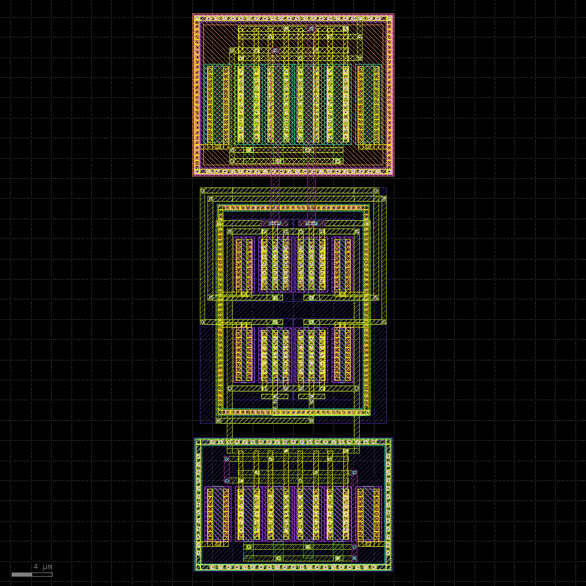
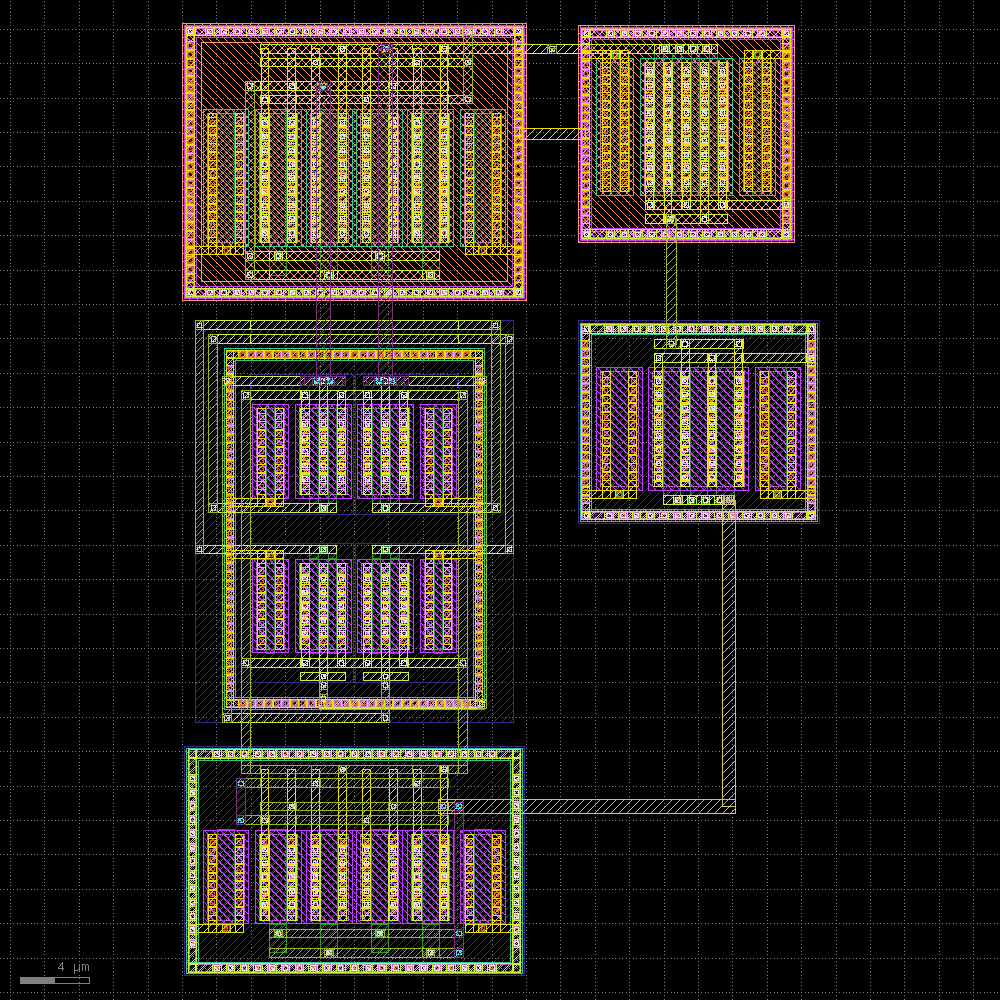
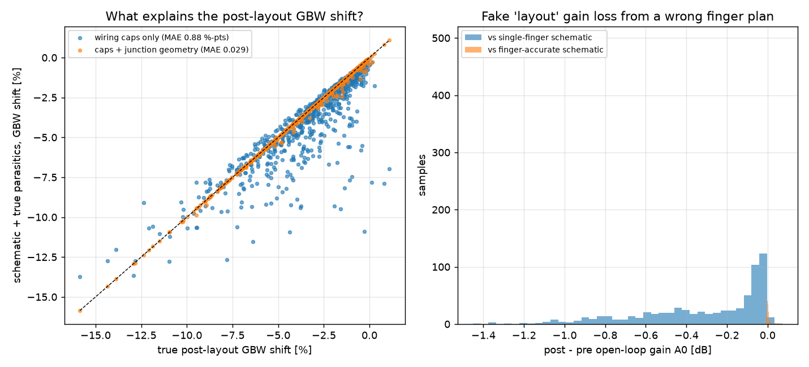
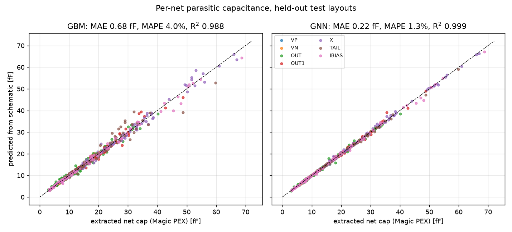
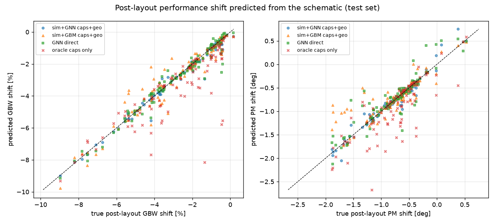

# Post-layout parasitic prediction from the schematic with a GNN (GF180MCU)

A graph neural network that looks at an analog **schematic** (transistors, sizes, finger plan,
connectivity) and predicts what the **layout** will add: per-net parasitic capacitance,
coupling between nets, and per-transistor junction geometry. Fed back into the pre-layout
simulation, these predictions reproduce the **post-layout GBW / phase-margin shift**
without drawing or extracting a layout. The training data is fully open source: auto-generated
GF180MCU layouts (gLayout), extracted with Magic, simulated with ngspice.

Prior art: *ParaGraph* (Ren et al., NVIDIA, DAC 2020). This is a small, reproducible
open-PDK version of the same idea.

## Why

Analog job descriptions keep asking for "post-layout extracted simulations" because the
schematic-to-layout gap is where analog designs miss specs. Pre-layout sims ignore wiring caps
and use idealised transistor junctions. The real numbers only show up after layout + PEX, days
later. A schematic-level predictor shortens that loop to milliseconds.

## Pipeline

```
 random sizing (gm/Id LUT, from project 1)
        │
        ▼
 gLayout auto-layout, GF180MCU 3.3 V      two topologies:  5T OTA  |  two-stage Miller OTA
        │                                  (LVS spot-checked with Netgen: all MATCH)
        ▼
 Magic PEX  ──►  extracted netlist: real transistor geometry + wiring caps (to substrate, coupling)
        │
        ▼
 net matching (colour refinement)  a_n2175_3456#  →  X, TAIL, ...
        │
        ▼
 ngspice, typical corner:  pre (finger-accurate schematic) | oracle caps | oracle caps+geo | post
        │
        ▼
 bipartite graph (devices ⇄ nets, edges labelled d/g/s/b)
        │
        ├── baselines: type mean, ridge, GBM on hand features
        └── GNN (hand-written message passing, plain PyTorch)
                 heads: pair caps C(i,j) · net totals · device AD/AS/PD/PS · ΔGBW, ΔPM
        │
        ▼
 predicted caps + geometry written into the schematic testbench → re-simulate → compare with post
```

<p align="center"> </p>
<p align="center"><em>Example generated layouts: 5T OTA (left), two-stage Miller OTA (right: stage 2 = M7/M8 on the right)</em></p>

## Results

**Dataset:** 702 auto-generated layouts (402 × 5T OTA, 300 × two-stage Miller OTA), Magic PEX,
loads 0.1–2 pF. 33 random layouts were LVS-checked with Netgen, and all 33 matched. Split by
sample: 491 train / 105 val / 106 test. Full tables: [results/results.md](results/results.md),
[results/ablations.md](results/ablations.md).

### 1. Where the post-layout shift comes from (all 702 layouts, no ML)

| pre-layout sim + ... | GBW-shift error vs real post-layout | PM-shift error |
|---|---|---|
| nothing (assume post = pre) | 3.2 ± 2.6 % shift ignored | — |
| true wiring caps only | 0.88 %-pts | 0.25° |
| true wiring caps + true junction geometry (AD/AS/PD/PS) | **0.03 %-pts** | **0.01°** |

So with a finger-accurate schematic, the post-layout shift is fully explained by **(1) wiring caps**
plus **(2) transistor junction geometry**. Shared diffusion between fingers makes real junctions
smaller than the schematic's default estimate, which partly cancels the wiring caps. These are the
two things the models learn. (A single-finger schematic would also show a fake ~0.3 dB gain
"loss" from narrow-width effects, so the reference schematic must carry the finger plan.)



### 2. Per-net parasitic capacitance (test set, signal nets)

| model | MAE [fF] | MAPE [%] | R² |
|---|---|---|---|
| type mean ("every OUT gets the average OUT cap") | 7.08 | 60.5 | 0.265 |
| ridge, hand features | 4.65 | 39.1 | 0.660 |
| GBM, hand features | 0.68 | 4.0 | 0.988 |
| **GNN** | **0.22** | **1.3** | **0.999** |

Coupling caps between signal nets: GNN MAE 0.028 fF (R² 0.997) vs GBM 0.085 fF (R² 0.963), with
the GBM given the same pair-structure features. Transistor junction geometry, MAPE averaged over
AD/AS/PD/PS: schematic default estimate ~26%, GBM ~5.8%, **GNN ~2.4%**.



### 3. Post-layout GBW / PM shift predicted from the schematic (test set)

True shift: ΔGBW = −2.8 ± 2.1 %, ΔPM = −0.76 ± 0.48°.

| method | ΔGBW MAE [%-pts] | ΔGBW R² | ΔPM MAE [deg] | ΔPM R² |
|---|---|---|---|---|
| ignore layout (post = pre) | 2.78 | −1.78 | 0.78 | −2.49 |
| oracle: true caps only | 0.72 | 0.62 | 0.22 | 0.43 |
| GBM direct regression | 0.59 | 0.85 | 0.23 | 0.44 |
| sim + GBM caps + geometry | 0.36 | 0.92 | 0.14 | 0.72 |
| GNN direct regression (graph head) | 0.26 | 0.96 | 0.13 | 0.81 |
| **sim + GNN caps + geometry** | **0.15** | **0.98** | **0.06** | **0.96** |
| (ceiling: true caps + true geometry) | 0.04 | 1.00 | 0.01 | 0.99 |

The GNN-predicted parasitics, written into the schematic testbench, get closer to post-layout
than the *true* wiring caps alone, because they also model the junction geometry.



### 4. Ablations

| experiment | result |
|---|---|
| no message passing (K = 0) vs K = 1 / 3 | net-cap MAPE 44.6 % → 1.7 % → 1.5 %: the graph context is what does the work |
| learning curve (122 → 491 training layouts) | GNN 2.0 → 1.5 %, GBM 5.2 → 4.0 % net-cap MAPE: the GNN with ¼ of the data still beats the GBM with all of it |
| zero-shot transfer (train on 5T OTA only → test on two-stage) | both poor: GNN 23 %, GBM 22 % net-cap MAPE. An unseen topology (new net type OUT1, new stage) is not free |
| few-shot transfer (+20 two-stage samples) | GNN 3.8 % vs GBM 6.3 % net-cap MAPE; geometry 5.2 % vs 9.9 % |

Honest reading: on these small, two-topology graphs a GBM with good features is already
decent (4 %), so the GNN's gain is in the details (couplings, junctions, data efficiency).
It is not a dramatic win over every baseline, and it does not generalise zero-shot to a new topology.

## How to run

Everything runs inside the `iic-osic-tools` container (`~/eda/designs` → `/foss/designs`).

```bash
docker start iic-osic-tools_shell_uid_1000
```

```bash
docker exec -d iic-osic-tools_shell_uid_1000 bash -lc "bash /foss/designs/postlayout_gnn/run_datagen.sh"
```

```bash
docker exec iic-osic-tools_shell_uid_1000 bash -lc 'cd /foss/designs/postlayout_gnn && python3 gen/resim_dataset.py --workers 3 && python3 model/plot_decomposition.py && python3 model/run_all.py && python3 model/ablations.py'
```

* Data generation is resumable (finished samples are skipped). Use `N_OTA`, `N_TS2`, `W_OTA`, `W_TS2`
  to set the sample counts and worker counts. Stop it with
  `docker exec -u root iic-osic-tools_shell_uid_1000 bash /foss/designs/postlayout_gnn/stop_datagen.sh`.
* gLayout scripts need the Python 3.10 venv: `/foss/designs/glenv/bin/python -E` (the `-E` matters).
* The ML part needs `torch` (CPU) and `scikit-learn` in the container's Python 3.12
  (`pip install --user --break-system-packages ...`).

| file | what |
|---|---|
| `gen/gen_ota5t.py` | 5T OTA samples: sizing → gLayout (reuses `analog_agent/layout/ota5t_layout.py`) → PEX → sims |
| `gen/twostage_layout.py`, `gen/gen_ts2.py` | two-stage Miller OTA layout (stage 1 = the 5T OTA, plus M7/M8 and explicit routing) and its generator |
| `gen/netlist_utils.py` | SPICE parsing, net matching, per-net caps, junction geometry, lumped-parasitic testbench netlists |
| `gen/pex_tools.py`, `gen/tb.py` | Magic PEX/LVS wrappers; ngspice open-loop testbench for both topologies |
| `gen/resim_dataset.py` | finger-accurate pre-layout sims + oracle sims for every sample |
| `model/dataset.py` | samples → bipartite graphs + targets |
| `model/baselines.py`, `model/gnn.py` | baselines; the GNN |
| `model/run_all.py`, `model/ablations.py`, `model/plot_decomposition.py` | experiments, plots, tables → `results/` |
| `NOTES.md` | plain-language explanations + interview Q&A |

## Limitations (honest list)

* **Two topologies, one layout generator.** The model learns gLayout's placement and routing
  style, not a human layout engineer's. Generalising to human layouts would need real data.
* **Capacitance only**, no wire resistance (fine for these compact blocks, not for long nets or RF).
* **Typical corner only** for the dataset sims. Parasitics barely depend on the corner, but the
  sensitivity of GBW to them does.
* **Small graphs** (6–8 transistors). This is exactly where a well-featured GBM is a strong
  competitor; the advantage of a GNN should grow with circuit size and diversity.
* **Cc and CL are ideal testbench capacitors** in the two-stage OTA (not laid out as MIM caps).
* DRC was skipped during data generation for speed. The building blocks are DRC-clean in project 1,
  but the extra stage-2 routing was not DRC-checked. LVS was checked on 33 random layouts (all matched).
* Zero-shot transfer to an unseen topology is poor (~22 % MAPE); a few examples of the new topology are needed.
